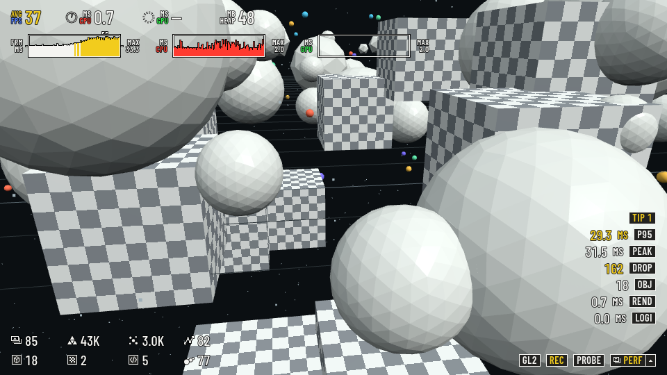
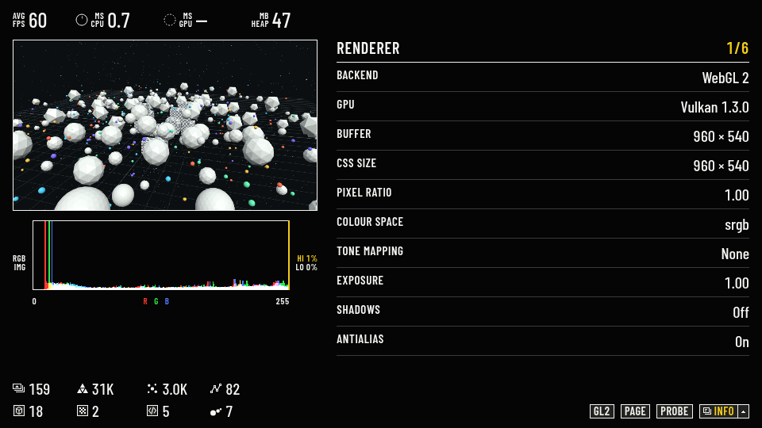
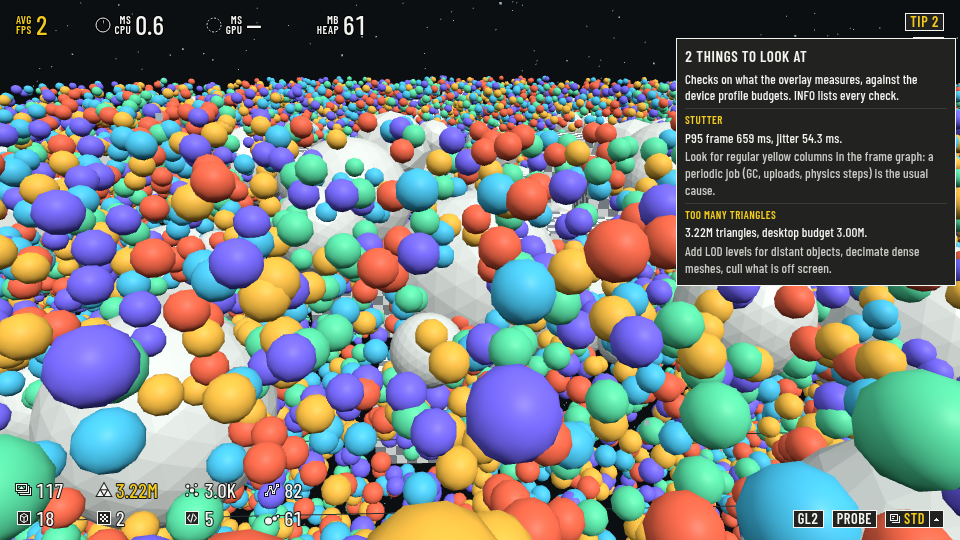
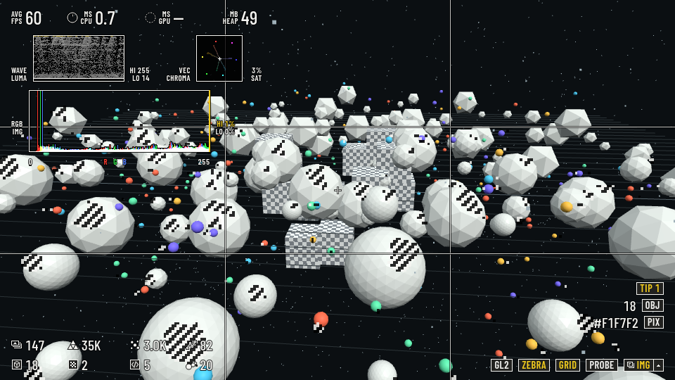
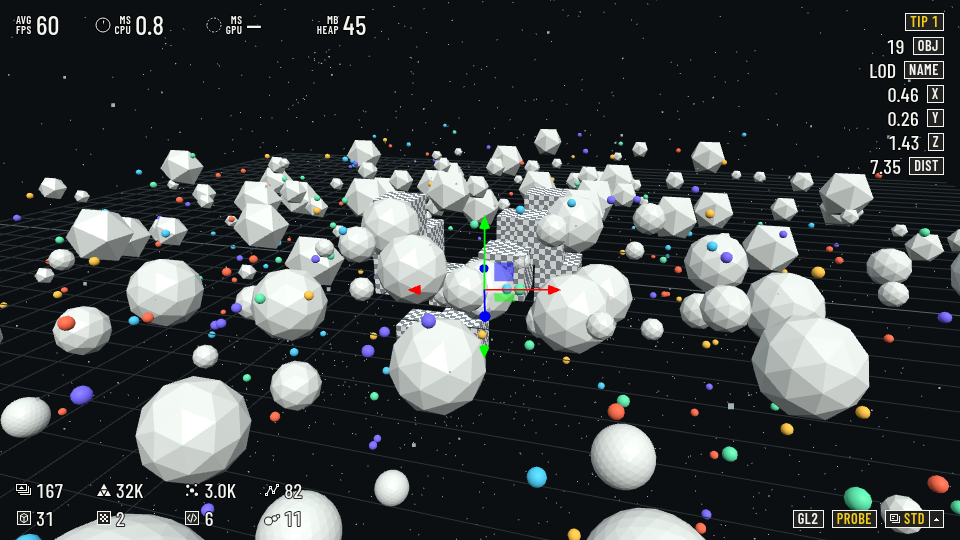

# @three.ez/stats

A statistics overlay for three.js, for `WebGLRenderer` and `WebGPURenderer`, that reads like a
camera's shooting display: small technical readouts on the edges of the canvas, so attention stays
on the scene. It measures, records and explains, for the people who build the scene and for the
agents that help them.



**[Live demo](https://stats-demo.vercel.app)** · [Graph showcase](https://stats-demo.vercel.app/showcase.html) · [Extending guide](docs/extending.md) · [For agents](docs/agents.md) · [Tools spec](docs/tools-spec.md)

```sh
npm install @three.ez/stats
```

```ts
import { Stats } from '@three.ez/stats';

const stats = new Stats(renderer, { scene, camera });

renderer.setAnimationLoop(() => {
  stats.begin();
  update();
  stats.mark('render');   // optional: splits CPU time into 'logic' and 'render'
  renderer.render(scene, camera);
  stats.end();
});
```

`three` is a peer dependency, developed and tested against r186. For GPU time on WebGPU, create
the renderer with `trackTimestamp: true`.

## Why it is built this way

A 3D environment is well organised when its cost is known: what each frame spends, what the
picture looks like in numbers, and what to change first. Most stats panels stop at an FPS number.
This one is designed around four ideas.

1. **Averages hide what people feel.** A scene at "58 fps" can still stutter. The overlay leads
   with frame pacing: the 95th percentile, the worst frame, the refreshes missed, and the 1% low
   frame rate in reports. The frame graph colours every late frame, so a hitch is a red column you
   can see, not a decimal you have to trust.
2. **A number without a verdict is homework.** Draw calls are 900: is that a problem? The overlay
   knows the device profile and its budgets, runs about thirty checks on what it measures, and
   says what is wrong with the numbers and one practical fix. Nothing is shown when nothing is
   wrong.
3. **The picture is data too.** Lighting and colour decide whether an environment works, and they
   are usually judged by eye on one monitor. The Image mode brings the tools of a camera's
   display to the render: histogram, waveform, vectorscope, zebra on clipped highlights, framing
   guides. Exposure and colour casts become something you can point at.
4. **Agents should read it as easily as people.** Everything on screen is also one call away as
   plain JSON, findings and advice included, so an AI agent improving the scene works from
   measurements instead of screenshots. See [For agents](#for-agents).

Two rules hold everything together:

- **Real values only.** Estimates are labelled "est."; what a backend cannot measure is "—",
  never a guess. The overlay does not change the scene or the render: in Info the canvas is scaled
  with CSS only, so every number stays true.
- **Simple API, opinionated interface.** You give a value and a name. The overlay decides layout,
  formatting, colour, animation, responsive behaviour and what happens when your code throws.

## What you see

Click the mode plate (bottom-right: a screen icon and the mode code) for the next mode; its arrow,
or a right click, opens the list. Every element has a tooltip with a legend; on touch, tap a
readout or long-press anything.

| Mode | Shows | Answers |
| --- | --- | --- |
| Simple | FPS, CPU and GPU ms with budget dials, heap, counters | Is it fine right now? |
| Performance | Frame, CPU and GPU graphs; P95, PEAK, DROP; `mark()` segments; REC | Where does the frame go, and does it stutter? |
| Mesh & instances | Draw calls and triangles over time | Is the scene too heavy to submit? |
| Memory | Heap, geometries and textures over time | Is something leaking? |
| Image | RGB histogram, waveform, vectorscope; ZEBRA, GRID, pixel readout | Is the picture exposed, balanced and framed? |
| Info | The canvas as a thumbnail beside pages: renderer, limits, programs, scene, camera, diagnostics | What exactly is this renderer, scene and camera? |
| Off | Only the mode plate | |



The always-on counters: draw calls, triangles, points, lines, geometries, textures, shader
programs. Draw calls and triangles turn yellow past the profile budget.

## The tools, and what each is for

### Frame pacing and the frame graph

One column per few frames, each keeping its slowest: white on time, yellow when it missed one
screen refresh, red when it missed two or more. A tick above a column is a shader compiled in
that frame; a flag is an event your app marked. On phones the three graphs merge into one, with a
lane underneath that keeps every late frame visible.

```ts
stats.mark('physics');        // CPU segments, shown as rows that add up to the CPU time
stats.event('level-load');    // a flag on the graph: what was the app doing when it hitched?
```

### Tips: budgets and diagnostics



A yellow `TIP n` plate appears when something is wrong; its tooltip lists each finding with its
numbers and what to do. Frame checks run once a second (GPU- or CPU-bound, stutter, shaders
compiled while running, allocations every frame, growing geometries or textures, draw calls,
triangles, pixel ratio, depth precision, a display faster than the budget). With a `scene`, every
few seconds: heavy or unmipped textures, too many lights or shadows, overdraw, instancing
candidates, disabled culling, oversized `BatchedMesh`.

| Profile | Draw calls | Triangles | Pixel ratio | Textures (est.) | Lights | Shadow lights | Shadow map |
| --- | --- | --- | --- | --- | --- | --- | --- |
| mobile | 250 | 750K | 2 | 256 MB | 4 | 1 | 2048 |
| desktop | 1000 | 3M | 2 | 512 MB | 8 | 3 | 4096 |

These are rules of thumb, not specifications: override any with `budgets`, switch checks off with
`rules`, and add your own:

```ts
stats.addRule({
  id: 'bodies', title: 'Too many bodies',
  check: () => (world.bodies.length > 500 ? { message: `${world.bodies.length} bodies.`, advice: 'Let bodies at rest sleep.' } : null)
});
```

### Image scopes: the artistic side



An environment is a picture before it is a frame time. The Image mode reads the rendered image as
a camera operator would:

- **RGB histogram**: exposure and clipping; coloured fringes are casts.
- **Waveform**: brightness per image column, so you see *where* the picture clips or goes flat.
- **Vectorscope**: hue as direction, saturation as distance from the centre. A cloud pulled off
  centre in a scene meant to be neutral is a colour cast from a light or an environment map.
- **ZEBRA**: stripes over clipped highlights, on the canvas itself.
- **GRID**: rule-of-thirds lines and a centre mark, to frame a shot.
- **PIX**: the colour under the pointer, as hex, with R, G, B and luma.

All of them read one 256×144 copy of the canvas, four times a second, only while the mode is on.
Values are the displayed image: after tone mapping and encoding, 8 bits per channel.

### Recording and reports

```ts
stats.startRecording();
// … play the level …
const report = stats.stopRecording();
// report.fps.low1, report.frame.p99, report.dropped, report.calls.max, report.events …
```

The `REC` plate in Performance mode does the same. A report is what you compare before and after
a change, attach to a bug, or assert in a test: renderer counters are deterministic, so
`expect(report.calls.max).toBeLessThan(300)` works in CI. Timings in headless browsers do not.

### Pressure signal, for adaptive quality

```ts
new Stats(renderer, {
  onPressure: (pressure) => {
    const ratio = renderer.getPixelRatio();
    if (pressure === 'high') renderer.setPixelRatio(Math.max(1, ratio - 0.25));
    if (pressure === 'low') renderer.setPixelRatio(Math.min(devicePixelRatio, ratio + 0.25));
  }
});
```

`'high'` after two seconds without room in the frame, `'low'` after four with plenty; it repeats
every two seconds while it lasts, so a controller can keep stepping. The overlay only signals:
what to change stays your decision.

### Camera

With `camera`, Info gets a Camera page (field of view, 35 mm equivalent focal length, near, far,
position) and a check for depth ranges wide enough to z-fight.

### Probe: pick, move, read coordinates (add-on)

```ts
import { addProbe } from '@three.ez/stats/probe';

addProbe(stats, { scene, camera, renderer, controls });
```



A `PROBE` plate. Click an object on the canvas: a gizmo appears and rows show its name, local
position and distance from the camera, live while you drag. `C` copies
`object.position.set(x, y, z)` for your code; `Escape` deselects. It imports three.js (r169 or
later) and moves objects, so it is an add-on with its own import, not part of the read-only
overlay.

## For agents

The overlay is built to be read by AI agents as well as by people: stable names, plain JSON, and
every problem paired with a fix.

```ts
const snapshot = stats.snapshot();
```

```json
{
  "version": 1,
  "frame": { "fps": 41.2, "cpu": 6.1, "gpu": 21.4, "heap": 88 },
  "pacing": { "p95": 33.4, "worst": 51.0, "dropped": 96, "jitter": 6.2 },
  "counters": { "calls": 1240, "triangles": 2100000, "geometries": 310, "textures": 42, "programs": 19 },
  "findings": [
    { "id": "gpu-bound", "title": "GPU-bound", "message": "GPU 21.4 ms for a 16.7 ms budget.", "advice": "Lower the pixel ratio, shadow map sizes or overdraw (transparent layers, full-screen passes) first." },
    { "id": "draw-calls", "title": "Too many draw calls", "message": "1.2K draw calls, desktop budget 1.0K.", "advice": "Merge static meshes, use InstancedMesh or BatchedMesh for repeated objects, share materials." }
  ],
  "scene": { "meshes": 1180, "instancingGroups": 6, "largestInstancingGroup": 240, "textureBytes": 402653184 }
}
```

Three ways in:

- **From the page**: every instance is listed in `globalThis.__THREE_EZ_STATS__`, so an agent
  driving a browser (Playwright, Chrome DevTools MCP) evaluates
  `__THREE_EZ_STATS__[0].snapshot()`. Turn it off with `expose: false`.
- **As tools**: `agentTools(stats)` from `@three.ez/stats/agent` returns three tools with JSON
  schemas (`three_stats_snapshot`, `three_stats_record`, `three_stats_set_mode`) for any
  tool-calling bridge.
- **WebMCP**: `registerAgentTools(stats)` offers the same tools to in-browser agents through
  `navigator.modelContext` where the browser has it. WebMCP is an early proposal, so this is
  best effort and has not been tested against a shipping implementation.

The loop that works: take a snapshot, fix the first finding, record a few seconds, compare the
1% low and P95 with the previous report, repeat. More in [docs/agents.md](docs/agents.md).

## Ship without it

```ts
import { Stats } from '@three.ez/stats/dev';
```

The same class in development; in a production build (Vite and webpack set the `production`
export condition from the build mode) it resolves to a stand-alone no-op of 1.7 kB (0.7 kB
gzipped), against 50 kB gzipped for the overlay. Your call sites stay as they are. The main entry is always the
real overlay, for apps that keep it in production behind a flag:

```ts
if (new URLSearchParams(location.search).has('stats')) {
  const { Stats } = await import('@three.ez/stats');
  stats = new Stats(renderer, { scene, camera });
}
```

## Build your own: modes, metrics, rules

The overlay is a small platform. A plugin for physics, networking, audio or your engine's own
systems is plain data, and inherits the whole interface: grid placement, dark contour, yellow
alerts, tooltips, touch behaviour, animations between modes, narrow-screen layouts.

```ts
stats.defineMode({
  id: 'physics', name: 'Physics', code: 'PHYS', description: 'Bodies and solver time.',
  graphs: [{ id: 'physics.ms', label: ['MS', 'PHYS'], scale: 'budget', unit: 'ms', read: () => solverMs }],
  metrics: [{ id: 'physics.bodies', label: 'Active bodies', place: 'top', plate: 'BODY', read: () => world.bodies.length, threshold: { above: 500 } }],
  controls: [{ id: 'physics.debug', label: 'DEBUG', description: 'Draw colliders', onChange: (on) => debugDraw(on) }]
});

stats.addRule({
  id: 'physics.slow', title: 'Slow physics',
  check: ({ budget }) => (solverMs > budget * 0.4 ? { message: `Solver ${solverMs.toFixed(1)} ms.`, advice: 'Lower the solver iterations or sleep resting bodies.' } : null)
});
```

| You write | You get |
| --- | --- |
| `addMetric({ id, label, read })` | A counter with a glyph or a plate, formatted, yellow past its `threshold`, with a tooltip |
| `graphs: [{ label, scale, read }]` | A scrolling graph with a contour, a scale label and a text alternative |
| `histogram: { channels, domain }` | A large RGB histogram with 1 px columns, clipping marks and axis ends |
| `distribution: { read }` | A bar split by share, vertical on wide screens |
| `controls: [{ label, onChange }]` | A toggle plate next to the mode plate |
| `addRule({ id, title, check })` | A finding on the TIP plate, in the snapshot and in reports |
| `tip: { title, text, legend, values, advice }` | A rich tooltip with a legend and live values |

What the overlay guarantees in return: an invalid definition is skipped with one console warning;
a `read`, `format` or `check` that throws shows "—" and is switched off after five failures;
nothing you register can throw into the app's frame. A plugin that also runs in production can
type against `@three.ez/stats/dev` and cost nothing there. The full reference is in
[docs/extending.md](docs/extending.md); `examples/lod.ts` is a complete plugin.

## Options

| Option | Default | |
| --- | --- | --- |
| `scene` | — | Scene for the scene survey: the Info page and the scene checks |
| `camera` | — | Camera for the Info page and the depth precision check |
| `mode` | `'simple'` | Initial mode (a remembered choice wins unless `remember: false`) |
| `remember` | `true` | Store the mode picked with the mode plate in localStorage |
| `budget` | `1000 / 60` | Frame budget in ms. Not detected: pass `1000 / 120` for a 120 Hz display |
| `profile` | `'auto'` | Device profile for the budgets: `'mobile'`, `'desktop'` or `'auto'` |
| `budgets` | profile | Override single budgets, e.g. `{ calls: 500, shadowLights: 0 }` |
| `rules` | all on | `false` turns the checks off; a list turns off those rule ids |
| `thresholds` | budget based | Alert bounds for `fps`, `cpu`, `gpu` |
| `interval` | `250` | Text refresh period in ms |
| `graphStep` | `3` | Frames per graph column; each column keeps its slowest frame |
| `interactive` | `true` | Tooltips and clickable plates; `false` makes the overlay passive |
| `exclude` | `[]` | Built-in ids to leave out: counters (`'points'`…), rows (`'p95'`…), `'rec'`, `'zebra'`, `'grid'`, `'pixel'` |
| `metrics` | `[]` | Extra metrics |
| `onPressure` | — | Called with `'high'`, `'low'` or `'ok'`, for adaptive quality |
| `onReport` | — | Called with the report of every finished recording |
| `expose` | `true` | List the instance in `globalThis.__THREE_EZ_STATS__` |

## Entries

| Import | What | Size (gzip) |
| --- | --- | --- |
| `@three.ez/stats` | The overlay | about 50 kB |
| `@three.ez/stats/dev` | The overlay in development, a no-op in production builds | under 1 kB in production |
| `@three.ez/stats/agent` | Tools for agents, WebMCP registration | about 1 kB |
| `@three.ez/stats/probe` | Pick and move objects (imports three.js) | about 2 kB plus `TransformControls` |

## What depends on the browser

- **GPU time**: WebGL needs `EXT_disjoint_timer_query_webgl2` (Chromium on desktop); WebGPU needs
  `trackTimestamp: true`. Elsewhere the readout is "—" and GPU checks stay silent.
- **JS heap**: Chromium only (`performance.memory`).
- **Long tasks**: Chromium only (Long Animation Frames).
- **Byte sizes** of textures and geometries are estimates from their dimensions and arrays; the
  GPU may pad or compress.

## Develop

```sh
npm start              # demo at /examples/index.html, showcase at /examples/showcase.html
npm run check          # build, lint, type-check, unit tests, package check
npm run test:coverage  # unit tests with coverage floors
npm run build:site     # static demo site in site/
```

## License

MIT
