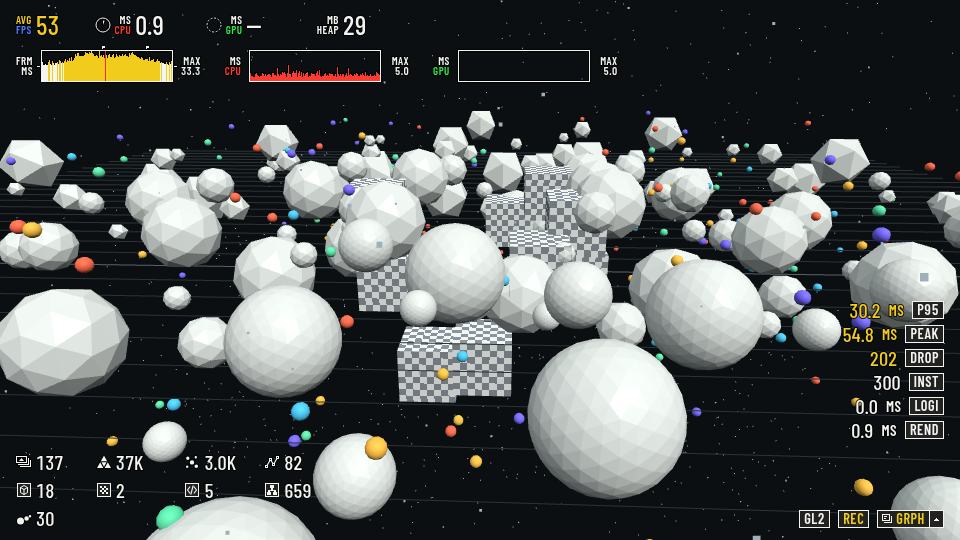
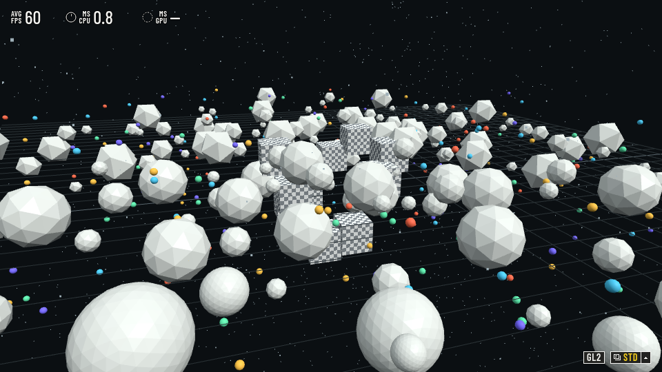

# @three.ez/stats

A statistics overlay for three.js, for `WebGLRenderer` and `WebGPURenderer`, that reads like a
camera's shooting display: small technical readouts on the edges of the canvas, so attention stays
on the scene. Three levels of detail, one plate to switch between them.



**[Live demo](https://three-ez-stats.vercel.app)** · [Guided tour](https://three-ez-stats.vercel.app/?tour) · [Graph showcase](https://three-ez-stats.vercel.app/showcase.html) · [Extending guide](docs/extending.md) · [For agents](docs/agents.md)

```sh
npm install @three.ez/stats
```

```ts
import { Stats } from '@three.ez/stats';

const stats = new Stats(renderer, { scene });

renderer.setAnimationLoop(() => {
  stats.begin();
  update();
  stats.mark('render');   // optional: splits CPU time into 'logic' and 'render'
  renderer.render(scene, camera);
  stats.end();
});
```

`three` is a peer dependency, developed and tested against r186. For GPU time on WebGPU, create
the renderer with `trackTimestamp: true`.

## Why it is built this way

- **It shows, it does not inspect.** A stats overlay stays open while you work, so it has to
  stay out of the way. It measures the renderer and the frame, and shows the numbers in three
  levels of detail. Inspectors and frame debuggers already exist (the three.js devtools,
  Spector.js, the browser's Performance panel); this is not one of them.
- **Averages hide what people feel.** A scene at "58 fps" can still stutter. Graph mode leads
  with frame pacing: the 95th percentile, the worst frame, the refreshes missed. The frame graph
  colours every late frame, so a hitch is a red column you can see, not a decimal you trust.
- **Real values only.** What a backend cannot measure is "—", never a guess. The overlay never
  changes the scene or the render.
- **Simple API, opinionated interface.** You give a value and a name. The overlay decides
  layout, formatting, colour, animation, responsive behaviour, and what happens when your code
  throws.

## What it touches, and what it never does

The overlay is a reader. It never changes your scene, its objects, materials, geometries,
textures or matrices, and it never changes your renderer or canvas. A test renders a real
three.js scene through every mode, with recordings and snapshots, and checks that the scene is
identical afterwards.

What it does touch, all of it undone by `dispose()`:

| | |
| --- | --- |
| The page | One overlay element on `document.body` and one `<style>` (removed with the last overlay) |
| The GPU | WebGL: one timer query per frame on your context, skipped while you run your own. WebGPU: it resolves the timestamps you enabled with `trackTimestamp`. `gpuTimer: false` turns both off |
| Storage | The mode you pick with the plate, in localStorage. `remember: false` turns it off |

Two things only happen when you ask:

- `countAllPasses: true` switches `renderer.info.autoReset` off while the overlay lives, so the
  counters sum every `render()` of a frame (post-processing, several views). By default
  `renderer.info` behaves as three.js defines it and the counters show the frame's last `render()`.
- `expose: true` lists the instance in `globalThis.__THREE_EZ_STATS__`, for agents driving the page.

## Modes

Click the mode plate (bottom-right: a screen icon and the mode code) for the next mode; its arrow,
or a right click, opens the list. The modes build on each other.

| Mode | Code | Adds |
| --- | --- | --- |
| Simple | `STD` | Frame rate, CPU time and GPU time, with budget dials |
| Performance | `PERF` | The JS heap and the renderer counters, bottom-left |
| Graph | `GRPH` | Frame, CPU and GPU time graphs; P95, PEAK and DROP; `mark()` segments; REC |
| Off | `OFF` | Nothing but the mode plate |




The counters: draw calls, triangles, points, lines, geometries, textures, shader programs and,
with a `scene`, the objects in it. Draw calls and triangles turn yellow past the budget of the
device profile (below). Every element has a tooltip with a legend; on touch, tap a readout or
long-press anything.

Your own modes join the cycle after Graph, before Off. The demo has two, built with the public
API: **Image** (an RGB histogram of the render, zebra on clipped highlights, framing guides, the
colour under the pointer) and **LOD** (objects per level, switches per second, triangles saved).
They live in `examples/`, not in the package.


## The frame graph

One column per few frames, each keeping its slowest: white on time, yellow when it missed one
screen refresh, red when it missed two or more. A tick above a column is a shader compiled in
that frame; a flag is an event your app marked. On narrow screens the three graphs merge into
one, with a lane underneath that keeps every late frame visible.

```ts
stats.mark('physics');        // CPU segments, shown as rows that add up to the CPU time
stats.event('level-load');    // a flag on the graph: what was the app doing when it hitched?
```

## Recording and reports

```ts
stats.startRecording();
// … play the level …
const report = stats.stopRecording();
// report.fps.low1, report.frame.p99, report.dropped, report.calls.max, report.events …
```

The `REC` plate in Graph mode does the same. A report is what you compare before and after a
change, attach to a bug, or assert in a test: renderer counters are deterministic, so
`expect(report.calls.max).toBeLessThan(300)` works in CI. Timings in headless browsers do not.

## Pressure signal, for adaptive quality

```ts
new Stats(renderer, {
  onPressure: (pressure) => {
    const ratio = renderer.getPixelRatio();
    if (pressure === 'high') renderer.setPixelRatio(Math.max(1, ratio - 0.25));
    if (pressure === 'low') renderer.setPixelRatio(Math.min(devicePixelRatio, ratio + 0.25));
  }
});
```

`'high'` after two seconds without room in the frame, `'low'` after four with plenty; it repeats
every two seconds while it lasts, so a controller can keep stepping. The overlay only signals.

## Budgets

| Profile | Draw calls | Triangles |
| --- | --- | --- |
| mobile | 250 | 750K |
| desktop | 1000 | 3M |

The profile is detected (`profile: 'auto'`: a finger on a small screen, or a mobile browser, is
`mobile`) or set; override single values with `budgets: { calls: 500 }`. They are rules of thumb,
used only to colour the counters.

## For agents

Everything on screen is one call away as plain JSON, so an AI agent improving the scene works from
measurements instead of screenshots.

```ts
const snapshot = stats.snapshot();
// { version: 2, frame: { fps, cpu, gpu, heap }, pacing: { p95, worst, dropped, jitter },
//   counters: { calls, triangles, … }, budgets, scene: { meshes, lights, textureBytes, … }, report }
```

- **From the page**: with `expose: true` every instance is listed in `globalThis.__THREE_EZ_STATS__`,
  so an agent driving a browser (Playwright, Chrome DevTools MCP) evaluates
  `__THREE_EZ_STATS__[0].snapshot()`.
- **As tools**: `agentTools(stats)` from `@three.ez/stats/agent` returns `three_stats_snapshot`,
  `three_stats_record` and `three_stats_set_mode` with JSON schemas, for any tool-calling bridge.
- **WebMCP**: `registerAgentTools(stats)` offers the same tools through `navigator.modelContext`
  where the browser has it. WebMCP is an early proposal: best effort, not tested against a
  shipping implementation.

More in [docs/agents.md](docs/agents.md).

## Ship without it

```ts
import { Stats } from '@three.ez/stats/dev';
```

The same class in development; in a production build (Vite and webpack set the `production`
export condition from the build mode) it resolves to a stand-alone no-op of 1.5 kB (0.6 kB
gzipped), against about 36 kB gzipped for the overlay. Your call sites stay as they are. The main
entry is always the real overlay, for apps that keep it in production behind a flag:

```ts
if (new URLSearchParams(location.search).has('stats')) {
  const { Stats } = await import('@three.ez/stats');
  stats = new Stats(renderer, { scene });
}
```

## Build your own

A plugin for physics, networking, audio or your engine's own systems is plain data, and inherits
the whole interface: grid placement, dark contour, yellow alerts, tooltips, touch behaviour,
animations between modes, narrow and short screens.

```ts
stats.defineMode({
  id: 'physics', name: 'Physics', code: 'PHYS', description: 'Bodies and solver time.',
  graphs: [{ id: 'physics.ms', label: ['MS', 'PHYS'], scale: 'budget', unit: 'ms', read: () => solverMs }],
  metrics: [{ id: 'physics.bodies', label: 'Active bodies', place: 'top', plate: 'BODY', read: () => world.bodies.length, threshold: { above: 500 } }],
  controls: [{ id: 'physics.debug', label: 'DEBUG', description: 'Draw colliders', onChange: (on) => debugDraw(on) }]
});
```

| You write | You get |
| --- | --- |
| `addMetric({ id, label, read })` | A counter with a glyph, or a row with a plate; formatted, yellow past its `threshold`, with a tooltip |
| `graphs: [{ label, scale, read }]` | A scrolling graph with a contour, a scale label and a text alternative |
| `histogram: { channels, domain }` | A large histogram, up to three channels, with 1 px columns and clipping marks |
| `distribution: { read }` | A bar split by share, vertical on wide screens |
| `controls: [{ label, onChange }]` | A toggle plate next to the mode plate, folded into its menu when there is no room |
| `tip: { title, text, legend, values, advice }` | A rich tooltip with a legend and live values |

What the overlay guarantees in return: an invalid definition is skipped with one console warning;
a `read` or `format` that throws shows "—" and is switched off; nothing you register can throw
into the app's frame. `examples/image.ts` and `examples/lod.ts` are complete plugins; the full
reference is in [docs/extending.md](docs/extending.md).

## Options

| Option | Default | |
| --- | --- | --- |
| `scene` | — | Scene for the objects counter and the snapshot's scene survey |
| `mode` | `'simple'` | Initial mode (a remembered choice wins unless `remember: false`) |
| `remember` | `true` | Store the mode picked with the mode plate in localStorage |
| `budget` | `1000 / 60` | Frame budget in ms. Not detected: pass `1000 / 120` for a 120 Hz display |
| `profile` | `'auto'` | Device profile for the counter budgets: `'mobile'`, `'desktop'` or `'auto'` |
| `budgets` | profile | Override single budgets, e.g. `{ calls: 500 }` |
| `thresholds` | budget based | Alert bounds for `fps`, `cpu`, `gpu` |
| `interval` | `250` | Text refresh period in ms |
| `graphStep` | `3` | Frames per graph column; each column keeps its slowest frame |
| `interactive` | `true` | Tooltips and clickable plates; `false` makes the overlay passive |
| `exclude` | `[]` | Built-in ids to leave out: counters (`'points'`, `'objects'`…), rows (`'p95'`…), `'rec'` |
| `metrics` | `[]` | Extra metrics |
| `onPressure` | — | Called with `'high'`, `'low'` or `'ok'`, for adaptive quality |
| `onReport` | — | Called with the report of every finished recording |
| `expose` | `false` | List the instance in `globalThis.__THREE_EZ_STATS__`, for agents |
| `countAllPasses` | `false` | Sum every `render()` of a frame; switches `renderer.info.autoReset` off until `dispose()` |
| `gpuTimer` | `true` | Measure GPU time (timer queries on WebGL, timestamp resolves on WebGPU) |

On phones with a notch, add `viewport-fit=cover` to the page's viewport meta: the overlay keeps its
edges inside the safe area.

## Entries

| Import | What |
| --- | --- |
| `@three.ez/stats` | The overlay |
| `@three.ez/stats/dev` | The overlay in development, a no-op in production builds |
| `@three.ez/stats/agent` | Tools for agents, WebMCP registration |

## What depends on the browser

- **GPU time**: WebGL needs `EXT_disjoint_timer_query_webgl2` (Chromium on desktop); WebGPU needs
  `trackTimestamp: true`. Elsewhere the readout is "—" and the dial is dashed.
- **JS heap**: Chromium only (`performance.memory`).
- **Byte sizes** in the scene survey are estimates from dimensions and arrays.

## Develop

```sh
npm start              # demo at /examples/index.html, showcase at /examples/showcase.html
npm run check          # build, lint, type-check, unit tests, package check
npm run test:coverage  # unit tests with coverage floors
npm run build:site     # static demo site in site/
```

## License

MIT
